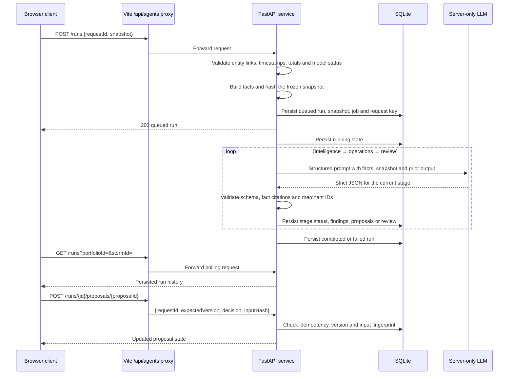

# CLIMADA three-stage agent workflow

This page describes the local agent service that sits beside CLIMADA's simulated business workspace. Business and numerical model records remain synthetic in this prototype; the configured LLM provider call is the live integration. The browser supplies one selected snapshot, the FastAPI service validates and freezes it, and one in-process worker runs three ordered provider calls.

## Sequence

The operator follows four visible steps: **Analyse risk → Run agents → Review drafts → Complete tasks**.

1. Select the portfolio, storm and product rules, then run the risk analysis.
2. From Overview or Storm workspace, **Run agents** opens Agent workspace and starts one run. Existing in-progress runs open without starting another one.
3. Intelligence turns the bulletin and risk result into findings; Operations turns findings into task proposals; Review checks the proposals against the evidence. All three stages are automatic. AI review readiness is not human approval.
4. Inspect a draft and its evidence, then choose **Accept & open task**. The application opens that exact task in Actions & payouts.
5. Read the task instructions and evidence, perform the checks, acknowledge that the work has been done, and choose **Mark complete**. The acknowledgement is local UI state; the completion decision is saved by the agent API.

Accepted agent tasks appear before rule-based policy checks and payout batches. Completing a task never sends a message, creates a payout, or approves payment. Older snapshots stay available for reference but cannot be completed against changed inputs.



The browser polls while a run is `queued` or `running`. The backend never waits on a provider request while holding a SQLite transaction. It uses one worker for this local setup.

## Inputs and validation

`POST /api/agents/runs` accepts `{ requestId, snapshot }`. The snapshot contains:

- `portfolio`, including version and merchants;
- `storm`, `bulletin` and `rule`;
- `modelRun`, including `status`, `simulated`, `inputHash`, item payouts and totals;
- current browser `actions` and payout `batches`.

Before any model call, Pydantic and service validation check that:

- portfolio, storm, bulletin, rule, action and batch references agree with the model run;
- the model run is `completed` or `partial`;
- timestamps are ISO-8601 and the bulletin is not newer than `modelRun.asOf`;
- coordinates, coverage dates, merchant IDs, risk IDs and payout item IDs are valid and unique;
- `totalPayout` equals the item total and `affectedCount` equals eligible item count;
- batches contain known merchants and actions/batches belong to the selected snapshot.

The service creates facts from these validated records. Findings and proposals are checked against exact fact IDs; unknown citations or merchant IDs fail the run. Missing wind stays missing; it is never interpreted as zero risk. Partial or simulated inputs produce warnings, and a partial model result forces review to `needs_review` even if the provider says `ready`.

The browser snapshot is a local integration input. It is not trusted production authority. In a production deployment, policy, authorization and numerical model records would be server-owned and authenticated.

## Stages and persisted state

| Stage | Output | Persisted result |
|---|---|---|
| Intelligence | Summary and supported findings | `steps[intelligence]` |
| Operations | Summary, findings and up to three task proposals | `steps[operations]`, `proposals` |
| Review | Summary, findings, `ready` or `needs_review`, issues | `steps[review]`, `review` |

Every run also stores its IDs, versions, model name, model input fingerprint, facts, warnings, timestamps and safe error text. SQLite keeps the immutable snapshot, job state and transition history alongside the run.

## Human decisions

The proposal route is:

```text
POST /api/agents/runs/{runId}/proposals/{proposalId}
```

with:

```json
{
  "requestId": "unique-request-id",
  "expectedVersion": 7,
  "decision": "accept",
  "inputHash": "model-input-fingerprint"
}
```

Allowed transitions are:

| Decision | Required current state | New state |
|---|---|---|
| `accept` | completed run with a `ready` review; proposal `proposed` | `accepted` |
| `dismiss` | proposal `proposed` or `accepted` | `dismissed` |
| `complete` | proposal `accepted` | `done` |

These transitions record human review only. They never approve a payout, transfer funds, alter policy or send a notification. The browser can show accepted and completed tasks in Actions & Payouts, but the payout workflow remains a separate simulated business engine.

## Idempotency, versions and retry

Every create, retry and decision request has a `requestId`. The service stores its payload fingerprint and response. Repeating the same request is safe and returns the saved response; reusing the ID with a different payload is a conflict. Distinct runs are independent; the service does not guarantee semantic de-duplication of similar tasks across runs.

Every run has a monotonically increasing `version`. Retry and decisions require `expectedVersion`; proposal decisions also require an `inputHash` that matches the stored frozen run. A stale version or stored-run fingerprint returns a conflict. The UI separately checks current-browser freshness before enabling a decision; this client check is not trusted production verification. Historical accepted and completed proposals remain visible, but stale decisions are disabled.

If the provider fails, returns malformed JSON, cites unknown evidence or is unavailable, the current stage and run become `failed` with a sanitized error. At startup, queued or running jobs from a previous process are also changed to `failed` with an explicit interrupted-restart message. Only a failed or cancelled run can be retried, and retry creates a new run linked to its parent. The original snapshot is retained for traceability.

## Provider and local boundary

The default `LiveProvider` uses OpenAI's compatible chat-completions endpoint with `gpt-4.1-mini` and strict JSON schemas. The server reads `OPENAI_API_KEY` and related settings from the ignored `backend/.env` or process environment. No credential enters the snapshot, prompt facts, SQLite response, error text or browser response.

The local API allows the two Vite development origins and has no authentication. It is suitable for a local course prototype only. Agents have no external tools and no capability to modify authoritative records, execute payments or send messages.

## Ownership and external model handoff

Yuxuan owns the React UI, orchestration, FastAPI service, persistence, agent prompts and this integration boundary. Teammates own the A–D numerical components, their data preparation, validation and limitations; the repaired components are integrated under `modeling/`. The model supplies one versioned result that the browser places in the snapshot; the agent service reads and explains that result but does not implement its calculations.

## Endpoints

| Method | Path | Notes |
|---|---|---|
| `GET` | `/api/agents/health` | Provider configuration and model status |
| `GET` | `/api/agents/runs` | Optional `portfolioId` and `stormId` filters |
| `POST` | `/api/agents/runs` | Validate, freeze and queue a snapshot; `202` |
| `POST` | `/api/agents/runs/{runId}/retry` | Requires `requestId` and `expectedVersion` |
| `POST` | `/api/agents/runs/{runId}/proposals/{proposalId}` | Requires decision, version and input fingerprint |

The frontend uses `/api/agents` by default, with Vite forwarding it to `http://localhost:8000` (`127.0.0.1:8000`).

## Run and test

From `backend`:

```sh
python -m pip install -r requirements.txt
uvicorn app.main:app --host 127.0.0.1 --port 8000
```

From `backend`, run the backend tests in PowerShell with:

```powershell
$env:PYTEST_DISABLE_PLUGIN_AUTOLOAD='1'
python -m pytest tests -q
```

The verified backend result is 15 pytest cases. The frontend has 13 verified Vitest tests and eight standard Playwright tests. The opt-in live agent spec adds one verified Playwright test against the configured OpenAI `gpt-4.1-mini` provider with synthetic fixtures only; it consumes provider calls. From `frontend`, enable it with `RUN_LIVE_AGENT_TEST=1` and run `npx playwright test agents-live.spec.ts`. `TEST_CHROME` is optional when a managed Chromium executable is needed.
