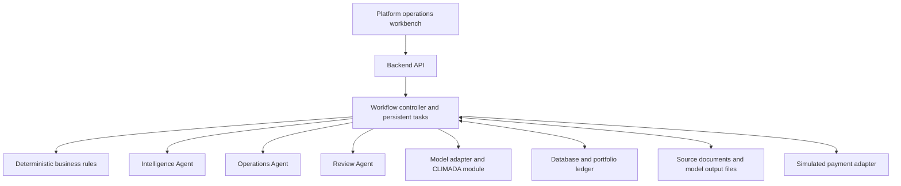
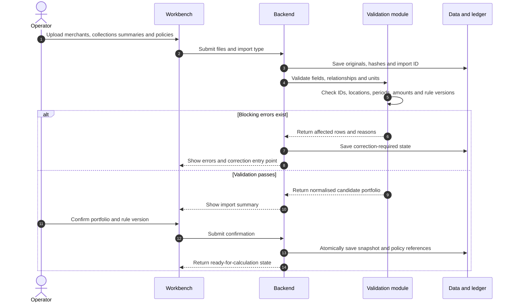
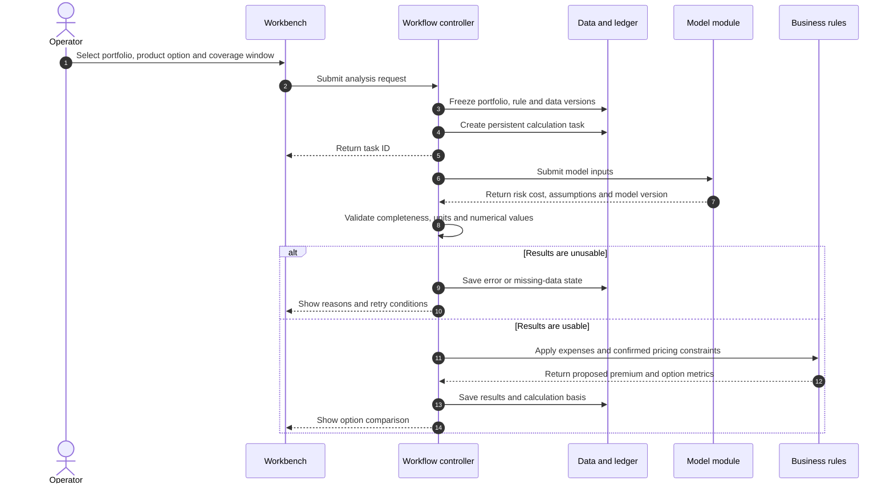
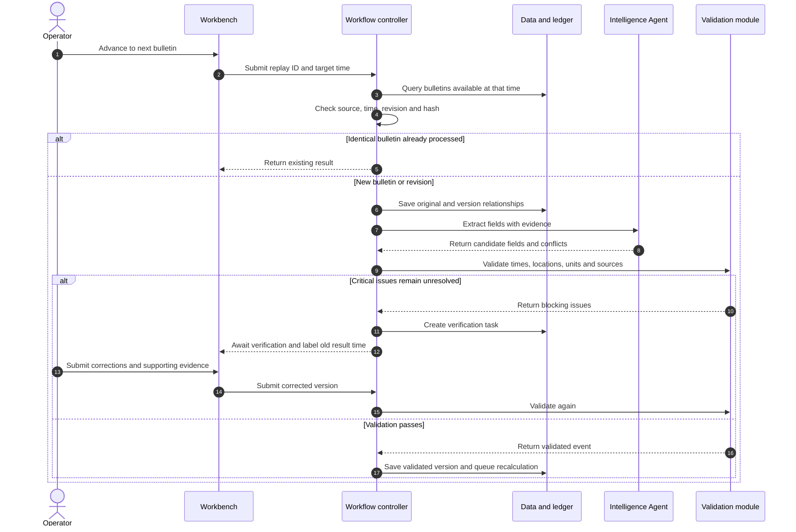
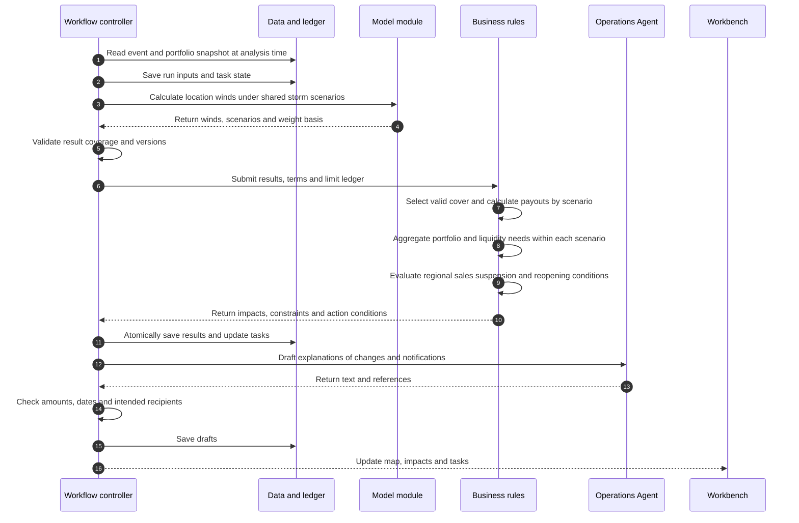
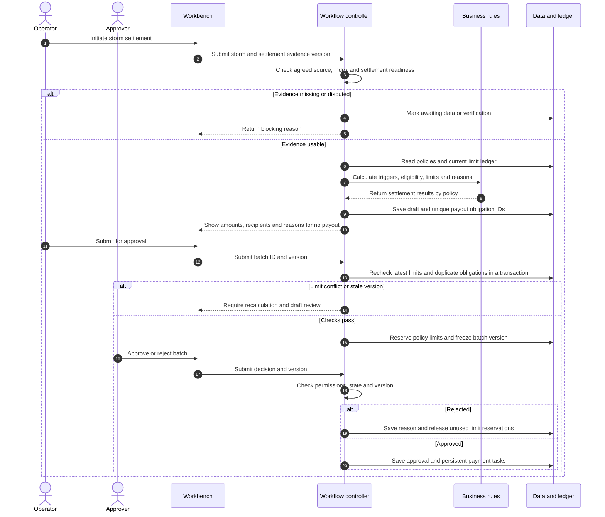
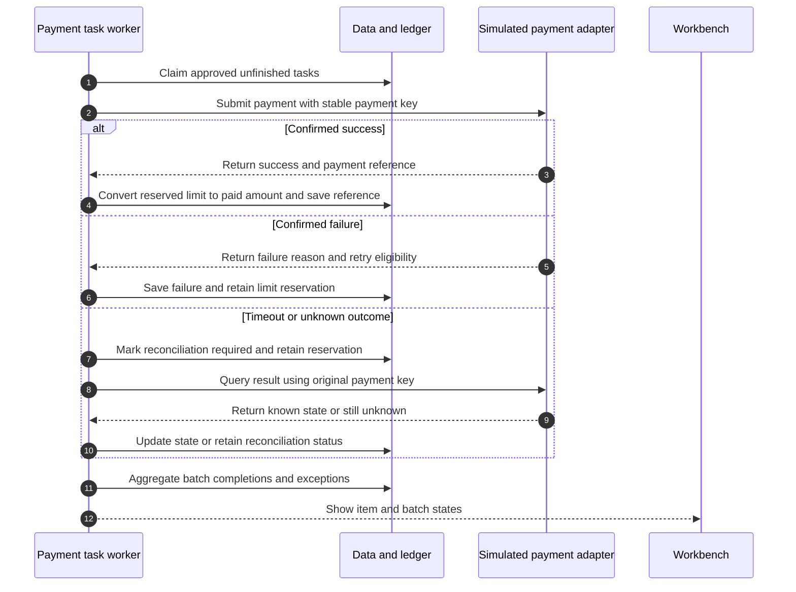
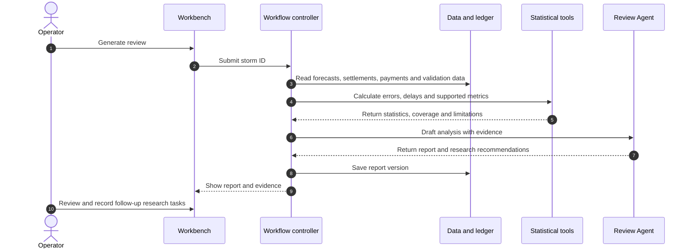

# CLIMADA Platform Architecture and Processing Sequences

Start here: [Project overview and team responsibilities](README.md).

English Discussion Draft v0.1. Date: 12 October 2026. Audience: product and systems lead and modelling team.

The project uses a single platform operations workbench. The platform imports existing or simulated merchants and policies; operators perform pricing analysis, storm replay, risk monitoring, action management and simulated payouts. The first version does not include a merchant enrolment interface or live policy issuance, notification delivery or payments.

This document defines processing sequences and handoff boundaries. Wind thresholds, waiting periods, sales suspension areas, payout tiers, aggregate limits and settlement data sources remain product rules to be confirmed. This document does not replace policy terms or establish regulatory conclusions. This English draft retains the unresolved items in the Chinese version.

## 1 Product scope and responsibilities

| Workstream | Owner | Deliverables |
|---|---|---|
| Product and interface | Product lead | Pages, operations, exception feedback and demonstration flow |
| Backend and business rules | Product lead | APIs, policies, ledger, state machines, approvals and simulated payments |
| Agent workflows | Product lead | Intelligence extraction, operational drafts, reviews and evidence tracking |
| Modelling and validation | Modelling team | CLIMADA wind fields, historical risk, scenario outputs and validation |
| Integration | Product lead, with modelling team | Model adapter, joint acceptance and complete replay |

See the [model handoff and interface specification](MODEL_HANDOFF.en.md) and the [business rules register](BUSINESS_RULES.en.md).

Pricing analysis allows operators to compare product options. It does not create binding quotes or policies. Imported policy terms remain fixed; analysing new rates does not change policies already in force.

## 2 Pages and backend capabilities

Use Foresail's workbench structure as a reference: tasks on the left, a map and bulletin timeline in the centre, and business impact on the right. Retain the information layout while redefining domain objects and interfaces for insurance.

| Page | User operations | Backend results |
|---|---|---|
| Portfolio and policies | Import, inspect errors, confirm a portfolio and view terms | Versioned portfolio, policies in force and data quality status |
| Product analysis | Select portfolio, rules and coverage window; compare options | Risk cost, proposed premium and unmet constraints |
| Storm workbench | Select a storm, advance bulletins and inspect areas and changes | Wind fields, risk ranges, sales suspension status and liquidity shortfall |
| Actions and payouts | Review drafts, submit for approval, simulate execution and reconcile | Batch versions, approvals, payment status and exceptions |
| Evidence and review | Open underlying evidence from a result and generate a review | Sources, run versions, statistics and draft reports |

Every page shows the data cutoff and whether data are real or simulated. While a calculation runs, retain the previous result with its timestamp. Failure, missing data and zero payout must have distinct states rather than all appearing as zero.

## 3 System components

The proposed stack consists of a React frontend, a Python API backend, an independent model module, SQLite for the prototype database and file storage. Model dependencies may run in a separate environment, exchanging files or structured results through an adapter. Long-running tasks do not hold frontend requests open; task state is persisted. Colab calls the same model code.

Code in the workflow controller determines task ordering, retries and pauses. Each of the three agents has a distinct assignment and structured output; agents do not independently change authoritative business state. The Intelligence Agent supplies candidate fields and sources. The Operations Agent supplies explanations and notification drafts. The Review Agent generates reports from tool-calculated statistics. Wind speeds, amounts, eligibility, deadlines and state transitions are handled by models or deterministic code. External documents are data, not a source of permissions for agents.

## 4 Sequence one Import the portfolio and rules

| Step | System processing | Stored result or failure handling |
|---|---|---|
| I01 Receive | Assign import ID, validate format and hash content | Preserve originals; do not directly overwrite authoritative data |
| I02 Validate merchants | Check unique IDs, coordinate bounds, region mappings and source labels | Invalid locations block the affected policies; they do not imply no risk |
| I03 Validate policies | Check merchant existence, start/end times, non-negative amounts, rule references and duplicate IDs | Return row-level errors; all blocking errors must be corrected before confirming the batch in version one |
| I04 Validate collections | Specify observation window, currency, refunds, missing days and simulated sources | Missing collections cannot establish that a merchant stopped trading |
| I05 Confirm | Save snapshot and references in a transaction; record the operator | Repeated confirmation returns the original result without duplicate inserts |

Historical replay imports must retain both business effective time and information availability time. Information entered after an event must not automatically enter predictions for an earlier point in time.

## 5 Sequence two Operational pricing analysis

| Step | System processing | Output |
|---|---|---|
| Q01 Freeze inputs | Bind portfolio, coverage window, payout rules, historical data and random seed | Input snapshot |
| Q02 Calculate | Model estimates pure risk cost using the same payout rules | Location or portfolio results, units and assumptions |
| Q03 Check quality | Validate location coverage, finite numbers, missing-data flags and result version | Success, partial completion or failure |
| Q04 Apply operating parameters | Use explicitly labelled expense, capital loading and pricing-constraint configurations | Proposed premium; unverified parameters remain labelled assumptions |
| Q05 Compare | Show costs, premiums and sensitivities; retain each option | No policy issuance or changes to existing policies |

Historical event frequency, the probability of at least one trigger and expected payout over the coverage period are different measures. With aggregate limits, simply prorating annual expected payout by coverage days cannot replace the full calculation unless that approximation is explicitly labelled and validated.

## 6 Sequence three Ingest and validate bulletins

| Step | System processing | Output |
|---|---|---|
| E01 Filter by time | Include only material published and available no later than the replay time | Input set without future information |
| E02 Deduplicate | Identify duplicates using source, bulletin ID, revision and hash | Do not re-extract identical content; create a new version for revisions |
| E03 Parse | Prefer deterministic parsing of structured sources; send text to the agent | Field values, units, source spans and sources |
| E04 Resolve identity | Map different agencies' names to a common storm ID | Await verification if uncertain; do not automatically merge |
| E05 Validate | Check coordinates, time sequences, units, wind definitions and critical missing fields | Validated event or blocking issue |
| E06 Correct manually | Retain original value, new value, evidence and operator; rerun validation | Calculation starts only after validation passes |

If historical forecasts are missing, a clearly labelled retrospective reconstruction may be demonstrated. A final track must not be presented as a forecast available at the time.

## 7 Sequence four Update risk and generate actions

| Step | System processing | Output or restriction |
|---|---|---|
| R01 Freeze analysis state | Save analysis time, portfolio, event and model versions | One consistent snapshot per run |
| R02 Run model | Apply one shared scenario set across all relevant locations | Do not independently shuffle merchant scenarios |
| R03 Check validity | Check location coverage, finite values, units and probability basis | An incomplete portfolio must not be labelled a complete total |
| R04 Calculate policy effects | Apply coverage periods, trigger tiers and per-event limits to each scenario | Retain reasons for no payout and for inability to determine a result |
| R05 Handle limits | Distinguish paid, reserved and forecast obligations; analyse remaining limits | Forecasts do not reserve actual policy payout limits |
| R06 Aggregate portfolio | Sum within shared scenarios before calculating distribution metrics | Do not add independent extreme values for individual merchants |
| R07 Analyse liquidity | Distinguish gross payouts, net retention, payments due, available cash and recovery timing | Reinsurance receivables are not immediately available cash |
| R08 Update sales status | Apply configured regional states and reasons across all active storms | Reopen only after all applicable suspension conditions clear |
| R09 Update actions | Deduplicate by storm, region or batch, and action type | Update existing tasks instead of creating duplicates |
| R10 Draft | Generate text from saved results and verify numbers | Agent failure does not discard calculations; template drafts may be used |

Without validated scenario weights, show only scenario ranges. Single-storm scenarios cannot establish annual tail risk across multiple storms. Sequential storms can first validate ledger and cumulative liquidity handling; joint probabilities require separate analysis.

## 8 Sequence five Settlement and batch approval

| Step | System processing | Result |
|---|---|---|
| S01 Verify source | Check settlement source, wind definition, location mapping and data version | Forecast results do not automatically become settlement results |
| S02 Determine eligibility | Check coverage times, event attribution, terms and existing obligations | Each policy has a reason for triggering or not triggering |
| S03 Calculate amount | Apply payout tiers, per-event limits and aggregate limits | Retain calculation details; agents do not calculate amounts |
| S04 Draft | Generate obligation IDs and batch version | No cash reservation or automatic execution |
| S05 Submit | Check and reserve remaining policy limits in a transaction; a conflict invalidates the entire submission | Prevent two storms from consuming the same remaining limit |
| S06 Approve | Check role and frozen version; record time and reason | Changed amounts or recipients require new approval |

The business key for a payout obligation should include policy, storm and coverage component. Changing a calculation version must not create a new original obligation. Revisions use linked adjustment records. Product rules must specify the order in which aggregate limits are allocated; operator click order must not determine it accidentally. An unresolved earlier event may block settlement of a later event.

## 9 Sequence six Simulated payment and reconciliation

Successful items must not be paid again. Confirmed failures follow the retry policy; payment failure does not extinguish the insurance obligation, so policy limits must not be released automatically. Query unknown outcomes before retrying, and do not submit a new payment key. Cancellation requires confirmation that no payment occurred and an authorised decision, with the subsequent treatment of the obligation recorded. Duplicate result notifications are posted to the ledger only once.

The prototype adapter must demonstrate success, confirmed failure, and timeout followed by a successful status query. Switching roles manually is for demonstration only and must not be represented as production authentication.

## 10 Sequence seven Review

A decline in merchant collections may reflect changes in payment channels and cannot directly establish business interruption. Provincial housing losses cannot serve as merchant-level ground truth. Where evidence is insufficient, findings must remain unvalidated. Review recommendations must not automatically change existing policies or deploy model parameters.

## 11 Core objects and states

| Object | Key fields |
|---|---|
| PortfolioSnapshot | ID, version, business time, information availability time, source and simulation flag |
| Policy | Merchant, coverage start/end, terms version, sum insured, limits and currency |
| ProductRuleVersion | Trigger, settlement source, event definition, limits, effective period and evidence status |
| Bulletin | Source, original hash, publication time, valid time, revision relationships and storm ID |
| ModelRun | Input hash, data/model versions, task state, result location and missing items |
| Action | Type, subject, basis, responsible role, deadline and deduplication key |
| PayoutObligation | Policy, storm, coverage component, amount payable, calculation basis and adjustment links |
| PayoutBatch | Version, item summary, approval state and approval records |
| PaymentAttempt | Stable payment key, attempt ID, response state and payment reference |
| AuditEvent | Operator or service, before/after versions, time, reason and request ID |

Model tasks: QUEUED → RUNNING → SUCCEEDED / PARTIAL / FAILED / BLOCKED. Retries create attempt records rather than erasing prior failures.

Batches: DRAFT → PENDING_APPROVAL → APPROVED → EXECUTING → COMPLETED / PARTIAL_FAILURE / RECONCILIATION_REQUIRED. Rejection returns the batch to revision, creating a new version.

Store monetary amounts as integers in the smallest currency unit where possible. Store times in UTC and explicitly label the display timezone. Fix wind interface units, averaging periods and conversion methods while retaining original units.

## 12 Proposed APIs and handoff order

The following interfaces are proposed and are not implemented services. All write requests carry request_id; sensitive state changes carry expected_version. Repeated requests return their original result; stale versions return a conflict.

| Interface | Purpose |
|---|---|
| POST /imports; GET /imports/{id} | Import data and retrieve validation results |
| POST /imports/{id}/confirm | Confirm portfolio |
| POST /pricing-runs | Start operational pricing analysis |
| GET /jobs/{id} | Retrieve persistent task progress and errors |
| POST /replays/{id}/advance | Advance bulletin time |
| GET /storms/{id}/workspace | Retrieve workbench summary for a consistent run version |
| POST /storms/{id}/risk-runs | Start risk recalculation |
| POST /storms/{id}/settlements | Create settlement draft |
| POST /payout-batches/{id}/submit | Freeze version and reserve policy limits |
| POST /payout-batches/{id}/approve or reject | Record approval decision |
| POST /payout-batches/{id}/execute | Start simulated execution |
| POST /payments/{id}/reconcile | Query an unknown payment outcome |
| POST /storms/{id}/reviews | Generate review draft |

A workbench response binds run_id and as_of so that the map cannot show a new bulletin while amounts come from an older calculation. Load detailed evidence on demand. Resetting a replay creates a new replay_id and isolated ledger; it must not delete the previous audit history.

Delivery order: first fix objects and model examples; then build frontend and backend with clearly labelled simulated results; integrate the CLIMADA model; finally validate sequential storms, exception recovery and review. Describe historical replay results separately from production real-time capabilities.

## 13 Joint acceptance scenarios

| Scenario | Required observable result |
|---|---|
| Same file or bulletin submitted repeatedly | No duplicate portfolios, actions or payments |
| Missing policy location | Show inability to calculate and affected count, not zero risk |
| Conflicting critical bulletin fields | Pause dependent calculations and revalidate corrections |
| Failed or interrupted model task | Retain old result timestamp; recover without repeating downstream actions |
| No credible scenario weights | Show ranges, not unsupported probabilities |
| Replay at an earlier time | No leakage from later bulletins, final tracks or facts recorded afterwards |
| Two storms compete for remaining limits | No excess payout; use agreed event ordering and require recalculation on conflict |
| Recipient list changed after approval | Previous approval is invalid for the new version |
| Payment times out but succeeds | Confirm by query and post once without duplicate payment |
| Partially failed batch | Process only unfinished items; successful items remain unchanged |
| Official settlement data revised | Preserve original evidence and create an adjustment workflow; do not overwrite payment history |
| Agent unavailable | Retain numerical results; use template drafts or await manual handling |

## 14 Reference basis

This architecture follows the project's merchant proposal and the platform-only scope agreed in discussion. Local Foresail reference files are `memory/foresail-architecture.md`, `ForeSail/frontend/src/pages/CaseWorkspace.tsx`, `ForeSail/frontend/src/components/WorkspaceOverview.tsx` and `ForeSail/backend/app/agents/monitoring_agent.py`. They support layout and workflow design, not this project's insurance rules.
