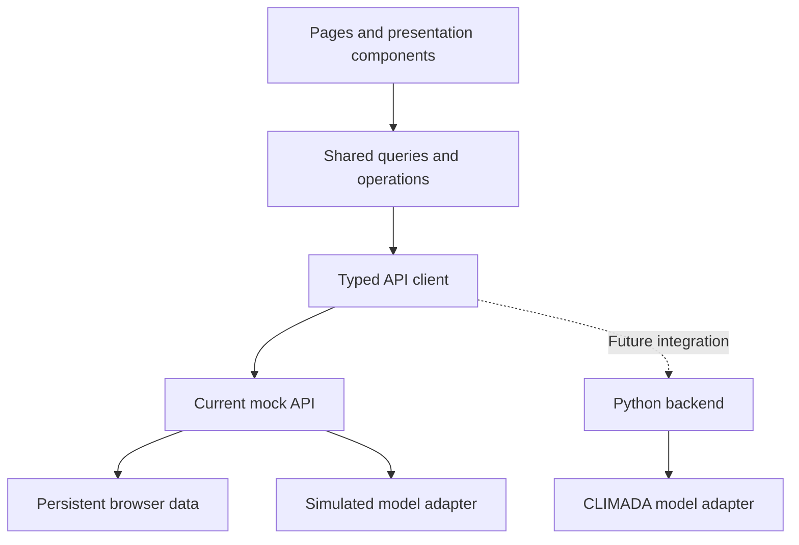

# CLIMADA Frontend Implementation Plan

Implementation baseline v0.2 · 12 October 2026 · [Project overview](README.md)

Build a Foresail-inspired platform operations workbench with linked business data and a replaceable model integration boundary. The first frontend release is implemented in `frontend/`, using simulated model outputs and payments. The [frontend guide](../frontend/README.md) describes the running implementation and its current limits; this document records the design and acceptance criteria.

**First deliverable:** import a portfolio → advance a storm bulletin → calculate simulated risk → inspect linked map, impact and action results. Extend that working path to settlement, approval and simulated payment before adding further interface features.

## 1 Scope and ownership

Yuxuan owns the frontend, mock service, backend integration, business workflows and final demonstration. The modelling team supplies the independent model module and its validation, as defined in the [model handoff specification](MODEL_HANDOFF.en.md).

The product has one platform operations interface, with no merchant enrolment frontend. Operational pricing analysis does not issue policies. Existing or simulated merchant policies are imported. Notifications remain drafts and payments are simulated.

“Linked modules” means that portfolios, storms, policies, actions, payout batches and evidence refer to the same records and versions across pages. It does not mean that this application shares live data with Foresail.

## 2 UI direction and pages

Use Foresail's light grey canvas, muted blue accents, dark action area, rounded controls and map-led workbench as the visual reference. Use English UI copy and prioritise desktop operations while adapting tables, navigation and panels to smaller screens. Status must be conveyed by text as well as colour; keyboard focus and reduced-motion support are required.

Reuse the layout language, not trade-specific data or business rules embedded in Foresail components. Every visible navigation item and button must lead to implemented behaviour.

| Page | Main content | Data relationship |
|---|---|---|
| Portfolio | Import, merchants, policies and data-quality issues | Establishes the portfolio used in later operations |
| Pricing | Portfolio, rule version, coverage window and option comparison | Reads shared portfolio data and calculation results |
| Storm Workspace | Map, bulletin timeline, risk changes and tasks | Main operational surface, tied to a specific run |
| Actions & Payouts | Drafts, payout items, approval and simulated payment | Generated from calculation and settlement records |
| Evidence | Bulletins, model runs, calculation basis and approval history | Reachable from each business result |

The storm workbench has a context bar showing the selected portfolio, storm, data cutoff and simulation status. Below it, place tasks on the left, the map and timeline in the centre, and portfolio impact on the right.

## 3 No hard-coded business values or implicit prefilling

- A fresh workspace starts empty. It does not automatically contain merchants, storms, policies or monetary amounts.
- Provide explicit **Import portfolio** and **Load demo dataset** actions. Sample records enter the shared data store only after the user chooses to load them.
- New analysis forms do not silently select a portfolio, storm, product option or business parameter. Placeholders and validation guidance are allowed.
- Editing an existing record shows its saved values. Restoring a previously selected workspace is distinct from creating fictional prefilled records and must use persisted state.
- Components do not own independent sample arrays, precomputed headline totals or special cases for particular merchant or storm names.
- Demo rules are separate, versioned and visibly labelled. Unresolved product terms are not hidden as production defaults.
- Mock model results are reproducible from the input snapshot, rule version, model version and seed. Relevant input changes must change the corresponding outputs; do not generate fresh arbitrary values on each render.
- Fixed field definitions such as policy ID, coordinates, currency and coverage dates are required interface contracts. Avoiding hard-coded values does not mean avoiding typed schemas.

Simulated wind and risk outputs must be labelled as demonstration results, not as CLIMADA calculations or validated forecasts.

## 4 Data and integration architecture

Proposed frontend stack: React, TypeScript and Vite. Use TanStack Query for fetching, caching and synchronising server-style state, and MSW for request-level API simulation. Their roles follow the [TanStack Query overview](https://tanstack.com/query/latest/docs/framework/react/overview) and [MSW documentation](https://mswjs.io/docs/).

Persist demo records in IndexedDB so refreshes do not lose the workflow. Components use the API client, not direct storage access or model calls. Keep UI-only state, such as an open panel or table filter, separate from business records.

The mock API should process operations against a shared repository rather than return unrelated static responses. It emulates tasks, version checks, rule execution and payment states. It is a development service, not a production authority.

When the Python backend is available, disable mock interception and use the real API with the same validated response contracts. Production business decisions, permissions and ledger changes execute on the backend. Browser-side mock logic is replaced, not trusted as production enforcement. Use shared input/output examples to detect divergence between implementations.

Suggested code boundaries:

| Area | Responsibility |
|---|---|
| app | Shell, routing, providers and navigation |
| features | Portfolio, pricing, storms, actions/payouts and evidence pages |
| components | Reusable visual controls and panels |
| contracts | Typed entities, requests, responses, units and validation |
| api | Request client, queries, mutations and task polling |
| mocks | Request handlers, deterministic demo calculations, fixtures and persistence adapter |
| styles | Shared design tokens, layout and interaction states |

## 5 Shared records and update propagation

Use the domain objects already defined in the [system architecture](ARCHITECTURE.en.md): portfolio snapshots, policies, rule versions, bulletins, model runs, actions, payout obligations, batches, payments and audit events. Link them with stable IDs and explicit versions.

Queries must include the relevant portfolio, storm, replay and run identifiers. Updating one entity invalidates or refreshes the related queries; it must not leave unrelated page-local totals behind.

| Operation | Required propagation |
|---|---|
| Import a portfolio | Update policy list, portfolio summaries and available analysis inputs |
| Switch portfolio | Switch map, risk, actions and payout lists together; isolate old cached results |
| Advance a bulletin | Create a new task and retain the prior result with its timestamp |
| Complete a calculation | Switch map, impact amounts and derived actions to a consistent run snapshot |
| Create payout draft | Derive items from the selected settlement basis and policy records |
| Approve a batch | Update tasks, batch state and reserved policy limits |
| Confirm payment success | Update payout items, remaining limits, batch totals and audit history |

Dependent analyses become stale when their input snapshot or candidate rule version changes. Keep old results for audit; require a new run for the new inputs. In-force policy terms remain fixed when a new rule version is introduced.

Changing an approved batch's recipients or amounts invalidates its approval. A new forecast bulletin does not automatically invalidate completed settlements. A revised settlement source follows a linked adjustment workflow.

Avoid optimistic success states for approvals and payments. Show pending status until the service confirms the operation.

## 6 Model boundary and task states

The frontend submits a calculation request, receives a task ID, polls progress and reads the result. It does not depend on CLIMADA's internal Python objects or storage format.

Results must expose run ID, input version, model version, rule version, analysis cutoff (`as_of`), location-linked outputs, units, data coverage and a simulated/authoritative indicator.

Support these distinct display states: not run, queued/running, completed, partially completed, failed and waiting for data. A result may additionally be stale. Missing values are not zero payouts.

The simulated adapter must also exercise delayed completion, incomplete results and failure. It must not return success for every input. On failure, the UI keeps any prior valid result with its original timestamp and provides the appropriate next action.

## 7 Implementation stages

| Stage | Work | Exit criterion |
|---|---|---|
| 1 Foundation and contracts | Design tokens, shell, routes, entities, API client, mock service and persistence | Fresh empty state works; explicitly loaded sample data drive the same portfolio across pages |
| 2 Core workbench | Portfolio import, policy details, map, bulletin replay, risk results and actions | Relevant input changes produce consistent linked results |
| 3 Complete workflow | Settlement drafts, approvals, limit reservations, simulated payment and reconciliation | One storm runs end to end; state survives refresh |
| 4 Complete and verify | Pricing comparison, evidence details, responsive behaviour and exception states | Linked workflow and failure scenarios pass acceptance checks |

Build one complete operational path before expanding the number of screens or agents. Detailed backend sequences remain in the architecture document rather than being duplicated here.

## 8 Acceptance checks

| Check | Expected behaviour |
|---|---|
| Fresh visit | No silently prefilled business records or selections |
| Explicit sample loading | Creates labelled data through the shared service; repeated loading does not duplicate records accidentally |
| Two portfolios | Switching between them does not mix policies, map points, actions or payout records |
| Reproducible simulation | Same frozen inputs produce the same result; changes to relevant inputs affect results |
| Bulletin progression | No new map paired with old amounts presented as a single current result |
| Upstream changes | Dependent analyses are visibly stale; old versions remain traceable |
| Invalid or partial data | Missing, failed, partial and zero-result states remain distinct |
| Repeated approval/payment | Repeated requests do not duplicate obligations or payments |
| Unknown payment outcome | Reconcile using the original payment key before attempting another payment |
| Reload | Portfolio selection and persisted workflow records remain consistent |
| Backend replacement | Contract tests run against mock and real adapters without rewriting page logic |
| Browser quality | Build/type checks, keyboard operation, responsive layout and the primary end-to-end flow pass |

Validate the core path with meaningful browser tests, including cross-page propagation, persistence, stale results and payment idempotency. Add focused visual inspection at desktop and narrow widths. A functioning UI with simulated results is not evidence of model accuracy or production readiness.
