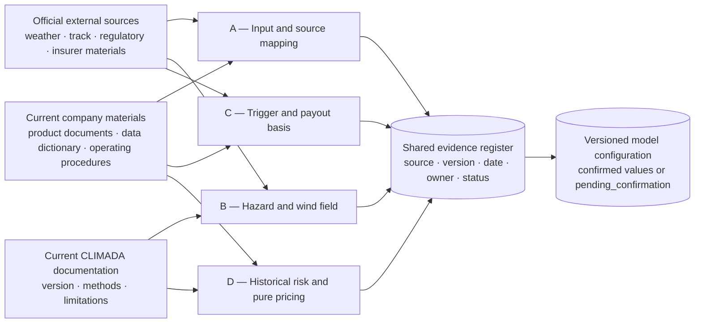
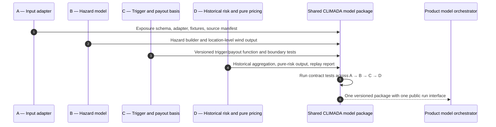
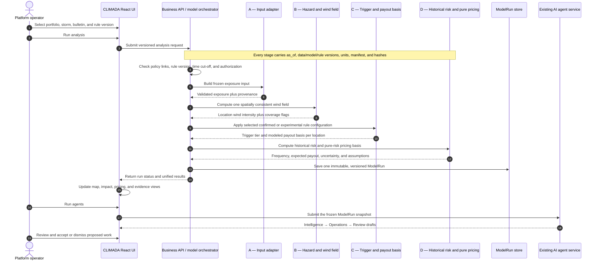

# CLIMADA Modeling Handoff Document — English Discussion Draft

Start here: [Project overview and team responsibilities](README.md).

## 1. Confirmed Boundaries and Division of Responsibilities

This handoff uses a single-platform architecture: the platform imports merchants and existing policies/coverage records; human operations staff calculate rates and risk in the back office. No merchant purchase frontend is built, and operational rate calculations do not directly issue policies. The Modeling team is responsible only for CLIMADA wind fields, historical risk, storm scenarios, and model validation, delivering reproducible pure-Python computational boundaries and result files. The user is responsible for the UI, backend rules, data orchestration, and agent integration.

The model layer does not create orders, decide final policies, send quotes to merchants, or execute payouts. Final policy payouts, coverage limits, eligibility, and effective-date rules are handled by the backend. The Modeling team calculates historical expected payouts and the pure risk premium basis using the shared payout rules; the backend handles fees, capital loadings, and pricing constraints based on that basis, and independently performs final settlement for in-force policies. The model and backend use the same payout-rule version; they must not add fees or apply limits twice. The proposal memorandum's content about GCash merchants, typhoon parametric risk, IBTrACS/CLIMADA/LitPop, and so on is background; where it conflicts with this handoff agreement, this agreement controls.

## 2. Where the Four Modeling Roles Fit

The four roles are components of one model pipeline. They are not four independent products, four competing models, or four direct frontend integrations. The product calls one versioned model boundary; the model package coordinates A → B → C → D and returns one `ModelRun`. The existing UI, agent workflow, human review, policy controls, settlement approval, and payment simulation remain owned by the product and integration lead.

| Role | Question answered | Research responsibility | Runtime component | Required handoff | Explicit boundary |
|---|---|---|---|---|---|
| **A — Company materials and input adapter** | What current company records and fields may the model use? | Collect current product documents, data dictionaries, operating procedures, policy examples, field definitions, effective dates, and source owners. Record conflicts and missing authority instead of resolving them silently. | Validate and transform a frozen portfolio/policy snapshot into the common exposure input. | Evidence register, field map, sample input, source/version manifest, and deterministic adapter. | A does not invent missing product terms or calculate wind, payouts, or prices. |
| **B — CLIMADA hazard and wind field** | What wind intensity does the same storm produce at each covered location? | Compare current CLIMADA behavior with the selected track, observation, and bulletin sources; document wind metric, units, resolution, time cut-off, and limitations. | Build or load the tropical-cyclone hazard and return one spatially consistent wind field for all locations. | Versioned hazard configuration, location-level wind results, coverage flags, tests, and source manifest. | B does not decide insurance eligibility, payout tiers, or premiums. |
| **C — Trigger and payout basis** | Given B's wind result and a versioned rule candidate, which tier is triggered and what modeled payout basis follows? | Trace confirmed rules to a current source; where terms are unresolved, design clearly labeled candidate configurations and compare them through boundary and sensitivity tests. | Apply the supplied, versioned confirmed or experimental rule configuration to the hazard result and exposure values. | Baseline and alternative candidate configurations, location-level trigger results, payout basis, reason codes, boundary tests, sensitivity results, and rule-version reference. | C may recommend a rule design but does not approve policy terms or make a final claim decision. |
| **D — Historical risk and pure-risk pricing** | Across historical events, what are the frequency, expected payout basis, and pure-risk premium basis? | Collect the approved historical period, event catalogue, frequency method, pricing basis, and any current company constraints that affect interpretation. | Aggregate historical B/C outputs into frequency, expected payout, uncertainty, and pure-risk pricing results. | Historical-risk output, pure-risk premium basis, assumptions, sensitivity results, and replayable report. | D does not add operating fees, capital loading, commercial margin, or issue a final customer price. |

Validation is part of every role's definition of done; there is no separate Role E. A validates schemas and provenance, B validates hazard coverage and wind fields, C validates trigger boundaries and payout calculations, and D validates historical aggregation, sensitivity, and replay. If a fifth teammate is available, that person pairs with A or B without creating a fifth integration boundary.

### 2.1 Research and configuration flow

Research happens before runtime. Company material and official external sources become a traceable evidence register. Confirmed entries become approved configuration. Role C may also create separately versioned experimental configurations for comparison; unresolved entries must remain visible as `pending_confirmation` and must not be presented as company terms.



The shared evidence register must contain at least: `topic`, `current_company_position`, `source_title`, `source_owner`, `source_url_or_file`, `publication_or_effective_date`, `retrieved_at`, `version`, `applies_to_this_project`, `status`, `gap`, and `decision_owner`. A source describing a different product or market may inform the gap analysis but cannot silently become this product's rule.

### 2.2 Build-time handoff between teammates

Each role delivers a reusable module to one shared Python package. Teammates do not connect their modules separately to the React application.



### 2.3 Product runtime sequence

The following is the target integration sequence. The current prototype uses a deterministic simulated model adapter at this boundary. Integrating the teammates' package replaces that adapter; it does not replace the existing UI or AI agent service.



The AI agents run after the numerical model. They may explain results and draft follow-up tasks, but they do not generate wind speeds, trigger tiers, payout amounts, probabilities, or premiums. A final settlement remains a separate backend decision using authoritative observations, in-force policy terms, limits, and human approval.

### 2.4 Unified product-facing result

The orchestrator must expose one result rather than four unrelated files. At minimum, it contains:

```text
model_run_id
model_version
rule_version
as_of
input_hash
output_hash
data_manifest
locations[].location_id
locations[].wind_speed_mps
locations[].data_status
locations[].trigger_tier
locations[].modeled_payout_basis
risk_summary.event_frequency_per_year
risk_summary.expected_payout_basis
risk_summary.pure_risk_premium_basis
validation.status
validation.warnings[]
```

`modeled_payout_basis` is numerical model evidence. It is not automatically the final payable amount. The backend remains responsible for policy eligibility, effective dates, deductibles or limits, duplicate-event handling, aggregate limits, approval state, and payment execution.

## 3. Data Contract

All inputs must include `as_of` (calculation cut-off), data version, and units. ISO 8601 time is recommended; use UTC internally, with Philippine time (PHT, UTC+8) optionally added for display. Coordinates are WGS84 decimal degrees; wind speed is in m/s, but “sustained wind/gust and averaging duration” remain pending confirmation; amounts are in PHP, while the minimum currency unit and rounding rules are pending confirmation; frequency is events/year, and probabilities use `[0,1]`.

| Input object | Required fields | Optional / notes |
|---|---|---|
| Model exposure input | `location_id`, `longitude`, `latitude`; historical expected payout calculation additionally requires a coverage window and coverage amount or unit coverage amount basis | Merchant-policy association is stored by the backend; when an existing coverage amount is available, daily average collections are not required; sensitive details do not enter model logs |
| Historical event/track | `event_id`, `observation_time`, track latitude/longitude, wind-speed metric, source, `published_at` | Wind radii/impact area, quality flags, observation or reanalysis label; every row must be traceable to a data version |
| Storm bulletin snapshot | `storm_id`, `bulletin_id`, `published_at`, path/intensity visible at that time | Forecast-cone geometry, hash of the bulletin source, retrieval time, parser version; a missing forecast cone need not block all calculations, but the limitation must be stated; a forecast cone cannot directly provide merchant trigger probabilities |
| Model configuration | CLIMADA/code version, grid or administrative-area version, threshold, coverage window, scenario seed | Impact function, frequency definition, correlation method, payout curve; undetermined parameters must be marked `pending confirmation` |

The main output fields are as follows. Missing or conflicting results must not be silently filled; return `status`, `reason_code`, the number of affected records, and record identifiers, and retain coverage.

| Output object | Required results | Use / boundary |
|---|---|---|
| Historical risk | `event_frequency_per_year`, `conditional_trigger_rate`, threshold exceedance distribution, `expected_payout_basis`, sample period, coverage | Provides the expected payout basis; it does not equal the final premium, policy coverage amount, or payout decision |
| Storm scenarios | `scenario_id`, shared wind-field/track version, peak wind speed at each exposure point, trigger indicators, scenario-weight status | Compute a weighted expected value only when external weights are available; without weights, it must be marked `unweighted` |
| Validation report | Metrics, observation period, model period, grouped results, basis risk, future-data checks, `pass/warn/fail` | For use by the backend and project acceptance; when thresholds are not confirmed, do not automatically claim pass |

Suggested missing-reason codes: `missing_coordinate`, `missing_hazard`, `unmapped_exposure`, `coverage_gap`, `version_conflict`, `future_data_rejected`, `invalid_unit`. If a merchant cannot be located or a key wind speed/timestamp is missing, return a non-computable result and do not output an estimate that looks precise.

## 4. Pure-Python Boundary (Implemented Historical Pipeline)

The repository now contains the canonical integration in `modeling/`. The implemented public boundary is `run_historical_model`, which coordinates A → B → C → D and returns one product-facing result while retaining the four detailed stage outputs for audit. It does not call an LLM, modify the business database, or obtain data from the network. The real B engine is guarded against runtime downloads; callers pass frozen tracks and manifests.

```python
from modeling import run_historical_model

result = run_historical_model(
    snapshot,
    historical_tracks,
    hazard_config,
    rule_config,
    risk_config,
    *,
    as_of: str,
    data_manifest: dict,
)
```

The returned object includes `model_run_id`, model and rule versions, input/output hashes, stage hashes, event-location trigger results, historical risk summary, combined validation, and the full `stages` audit envelope. The fixture engine supports deterministic contract tests; it is explicitly labeled synthetic and is not accepted as evidence about a real storm. Real hazard computation still requires the pinned CLIMADA environment in `modeling/requirements-climada.txt`.

`compute_historical_risk` must record “frequency” and “probability” separately: frequency is the expected number of events per year (for example, `lambda`), while probability is the chance of a trigger given an event or given a coverage window. Annual probability may be derived only after the frequency model, observation window, and aggregation method have been confirmed. A `compute_storm_scenarios` scenario set has no inherent probability; without calibrated scenario weights, probability must not be derived from scenario count, forecast-cone area, or model random seed.

Impacts of the same storm on multiple merchants use the same track and spatial wind field, retain spatial correlation, and cannot be independently sampled per merchant. Whether a storm occurs/how many occur (frequency) and how losses at each location change conditional on occurrence (within-event correlation) are modeled separately; they must not be mixed into one “probability” field. A forecast cone may have coverage meaning defined by the publishing agency, but it cannot be directly equated to a complete probability distribution for local wind speed or payout. Scenario weights should state the construction method, source, calibration period, and version.

## 5. Timing, Versioning, and Future-Information Isolation

Each run generates a manifest containing at least the dataset name, publication/version number, file hash, validity period, `as_of`, code commit ID, environment dependencies, configuration version, random seed, and run ID. Historical validation should replay bulletins one by one: at a given time point, read only bulletins with `published_at <= as_of` and merchant/policy data that already existed then; do not use the final track, post-event measured intensity, later bulletins, or fields revised after the fact. Save the forecast cone as the geometry published at that time; do not backfill ex-post probabilities.

Each replay snapshot outputs `input_hash`, `output_hash`, and `future_data_check`. If a timestamp later than the cut-off is found, return `future_data_rejected` immediately and list the rejected records in the validation report. Freeze, retention, or trigger actions after a named storm are determined by backend rules; the model only provides the risk results computable at that point.

## 6. Testing and Acceptance

The minimum test set includes: field and unit validation, coordinate bounds, repeat-run consistency under a fixed seed, ensuring that the trigger set does not expand when the threshold increases, rejecting calculation and returning a reason code when key fields are missing, a shared wind field across merchants for the same storm, no probability output without scenario weights, rejection of future bulletins during replay, no implicit network access or modification of the business database, traceability of file and cache operations, and reflection of version changes in the manifest. Use small fixed fixtures covering normal, empty-set, duplicate-event, cross-time-zone, version-conflict, and outside-coverage-period records.

Acceptance deliverables must include: field descriptions, error codes, input/output examples for the three functions, a locked data/code manifest, unit tests, and one replayable report. The memorandum proposed stop conditions such as “basis risk exceeds one-half, annual premium for a region exceeds PHP 1,200, and model frequency differs from observations by more than 2x”; these are discussion-only candidate thresholds, currently all marked `pending confirmation`, and must not be hard-coded into tests or backend rules.

## 7. Phased Delivery

1. **Phase 0: Contract and skeleton.** Fix fields, units, time conventions, error codes, the manifest, and test fixtures; complete empty implementations/examples for the three interfaces.
2. **Phase 1: Historical risk.** Connect frozen historical tracks and exposure examples, output frequency, threshold distribution, and `expected_payout_basis`, and complete the missing-data report.
3. **Phase 2: Storm scenarios.** Support a single bulletin snapshot, historical-track perturbations, and a shared wind field; without weights, deliver an unweighted scenario set only.
4. **Phase 3: Validation and replay.** Replay designated historical events bulletin by bulletin, complete basis-risk, model-skill, coverage, and future-leakage checks, and produce an auditable report.
5. **Phase 4: Backend handoff.** Deliver a versioned result package and call instructions; the user integrates the UI, shared payout rules in the backend, and the agent; the modeling team does not expand into policy issuance, final payouts, or limit decisions.

Pending parameters are registered centrally and not hidden in code: wind-speed definition (sustained wind/gust), grid/administrative-area granularity, trigger thresholds and tiers, coverage window, payout curve, event catalogue and frequency estimation period, scenario weights, correlation method, PHP rounding, shared payout-rule version, and acceptance thresholds.
