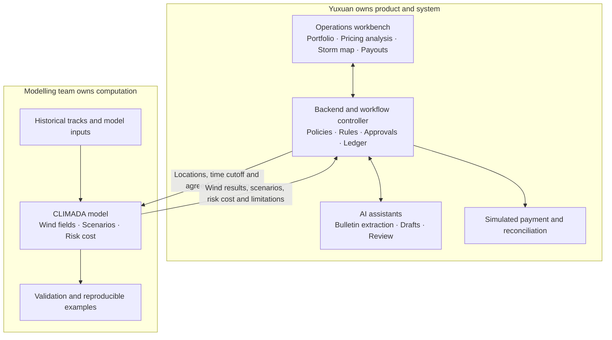

# GCash Merchant Typhoon Cover Project Overview and Team Responsibilities

English discussion draft v0.1 · 12 October 2026

We are building one platform operations workbench that turns typhoon information into portfolio risk estimates, operational actions and simulated payouts. Existing or simulated merchant policies are imported. There is no merchant-facing enrolment app in this prototype.

**Team split: Yuxuan owns the product and system; the modelling team owns the risk model and its validation.** Both sides agree on the model interface and payout-rule definitions before developing in parallel.

## 1 Overall architecture

**Main demo:** import a portfolio → advance a storm bulletin → calculate exposure → review actions → approve a payout batch → simulate payment → inspect the evidence.

Agents help read and explain information. Models and deterministic code calculate numbers; authorised people approve payout batches. The three software agents are not three additional human workstreams.

## 2 Who does what

| Work package | Accountable owner | Concrete deliverable |
|---|---|---|
| Product scope and rules | **Yuxuan** | User flow, proposed insurance terms and rule register; seek model feasibility input from the team |
| UI and frontend | **Yuxuan** | Foresail-inspired operations workbench, map, timeline and action/payout screens |
| Backend and integration | **Yuxuan** | APIs, imported policies, state management, limit ledger, approvals and simulated payments |
| Agent workflows | **Yuxuan** | Bulletin extraction, evidence-backed drafts and review, with deterministic validation |
| Data for modelling | **Modelling team** | Historical track and geographic inputs, preparation process, sources and versions |
| Risk calculations | **Modelling team** | Wind fields, shared storm scenarios, historical expected payouts and pure risk premium basis |
| Model validation | **Modelling team** | Reproducible notebook, validation results, assumptions and limitations |
| Final demo and project materials | **Yuxuan**, with model evidence supplied by the team | Integrated replay and consistent proposal/poster/demo outputs |

The modelling team does not need to build screens, APIs, agents or a payment system. Internal allocation among its members remains for that team to decide; no headcount or individual assignments are assumed here.

## 3 The handoff between the two sides

| Yuxuan supplies | Modelling team returns |
|---|---|
| Location IDs and coordinates | Wind results linked to the same location IDs |
| Analysis cutoff and coverage window | Scenarios that use only information available at that cutoff |
| Shared trigger, payout and limit rules | Historical expected payouts and pure risk premium basis under those rules |
| Agreed input/output format | Callable Python module, sample inputs/outputs and environment instructions |
| Demo cases and acceptance questions | Validation evidence, missing-data flags and known limitations |

**Boundary:** the model estimates risk cost; the backend applies pricing loadings and determines final payouts under each in-force policy. Forecast outputs do not themselves authorise payment. Unconfirmed thresholds and settlement sources remain explicit assumptions.

## 4 How we work in parallel

| Stage | Yuxuan | Modelling team | Shared checkpoint |
|---|---|---|---|
| 1 Agree the contract | Define the workflow and proposed rules | Check model feasibility and required data | Freeze a small sample input/output and list unresolved rules |
| 2 Build independently | Build screens and backend using labelled sample results | Build and validate the model module | Keep the agreed format stable; version changes explicitly |
| 3 Connect | Replace sample results with model outputs | Support integration and investigate model errors | Run one Rai replay end to end |
| 4 Verify and present | Test approvals, limits, retries and the final demo | Supply sequential-storm results and validation evidence | Confirm numbers, timestamps and limitations match across deliverables |

This split puts most implementation work with Yuxuan. Keep the first release to one workbench and one complete replay; add further interface features only after that path works.

## 5 Read further only when needed

- **Modelling team:** [Model handoff specification](MODEL_HANDOFF.en.md), for fields, functions and acceptance criteria.
- **System implementation:** [Architecture and seven processing sequences](ARCHITECTURE.en.md), for step-by-step handling and exceptions.
- **Product decisions:** [Business rules register](BUSINESS_RULES.en.md), for assumptions, evidence and unresolved terms.

Start with this overview; the other documents are implementation references, not required introductory reading.
