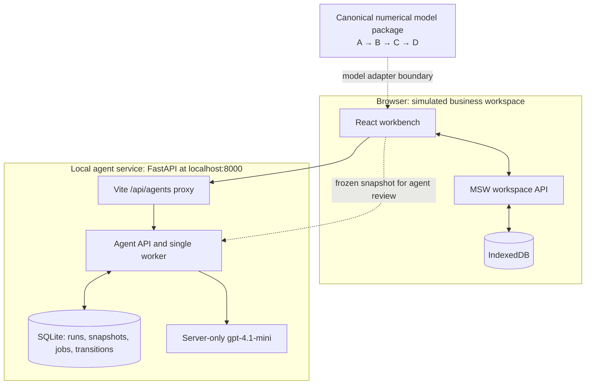

# CLIMADA project overview and ownership

CLIMADA is a local platform operations prototype for merchant typhoon cover. The browser workbench uses synthetic records to demonstrate portfolio analysis, operational actions and simulated payouts. A separate local FastAPI service runs evidence-backed LLM agents over a frozen browser snapshot.

## Overall architecture



The business engine and displayed numerical model records remain simulated: `VITE_DATA_MODE=mock` is the default, MSW serves the workspace routes and IndexedDB persists the local browser state. The repository now includes the integrated A → B → C → D Python package and a deterministic end-to-end contract test; connecting its public run result to the browser adapter is the next product integration step. The agent API is a separate live-provider integration over the frozen snapshot. Vite proxies `/api/agents` to the FastAPI service during local development. The browser-supplied snapshot is an integration input and is not production authority.

## Demonstration path

Load or import a portfolio → advance a synthetic storm bulletin → run the browser risk analysis → start **Intelligence → Operations → Review** → inspect citations and draft tasks → accept, dismiss or complete a proposal → continue to the separate simulated action and payout workflow.

Agents explain and draft. They do not calculate authoritative amounts, change policies or rules, approve or pay payouts, or send notifications. A human remains responsible for every proposal decision and business action.

## Ownership

| Area | Owner | Boundary |
|---|---|---|
| Product scope and workflow | **Yuxuan** | User flow, rules register and acceptance questions |
| UI and browser state | **Yuxuan** | React pages, MSW/IndexedDB business simulation and agent client |
| Orchestration and backend | **Yuxuan** | FastAPI routes, queue, SQLite persistence, validation, retries and decisions |
| Agent prompts and integration | **Yuxuan** | Three-stage advisory workflow and evidence boundary |
| External numerical model | **Modelling teammates A–D** | A: evidence and input adapter; B: hazard and wind field; C: trigger and payout basis; D: historical risk and pure-risk pricing |
| Final integration and presentation | **Yuxuan**, with model evidence from teammates | One replay with consistent facts, versions and limitations |

The four modelling roles form one A → B → C → D pipeline and expose one versioned model result to the product. They do not connect four separate models to the frontend. Validation is included in each role rather than assigned to a fifth integration boundary. The full team-position diagram, runtime sequence and acceptance boundary are in the [model handoff specification](MODEL_HANDOFF.en.md#2-where-the-four-modeling-roles-fit).

The modelling team does not need to build the screens, agent API, backend persistence or payment simulation. The agent backend consumes the model result carried in the snapshot; it does not replace the numerical model.

## Agent workflow boundary

The service freezes and validates a snapshot before queueing a run. It generates a server-side fact catalog, then calls the provider sequentially:

- **Intelligence:** identify supported changes, gaps and context from the bulletin and risk evidence.
- **Operations:** draft up to three concrete review tasks with exact fact citations.
- **Review:** check citations, simulation labels, completeness and stage consistency.

Runs, stages, facts, warnings, proposals and transitions persist in SQLite. A process restart marks queued or running work failed and requires an explicit retry. Request IDs make mutating calls idempotent; expected versions and the stored-run input fingerprint protect persisted decisions. The UI checks current-browser freshness before enabling a decision, but that check is not production verification. Partial model results remain visible but cannot produce a `ready` review.

Human proposal states are `proposed → accepted → done`, or `proposed/accepted → dismissed`. Historical accepted and completed proposals remain visible, while stale decisions are disabled. Acceptance is an operational record only. It does not call the browser business engine and cannot release a payout. Distinct runs are independent and do not have a semantic duplicate-task guarantee.

## Run locally

Start the backend from `backend`:

```sh
python -m pip install -r requirements.txt
uvicorn app.main:app --host 127.0.0.1 --port 8000
```

Keep one worker. Configure the server-only provider in the ignored `backend/.env` using `.env.example`; the local model default is `gpt-4.1-mini`. Never expose that key to the frontend or commit it.

Then start the frontend from `frontend`:

```sh
npm ci
npm run dev
```

The root [README](../README.md), [frontend guide](../frontend/README.md), [backend guide](../backend/README.md) and [agent workflow reference](AGENT_WORKFLOW.en.md) contain the short setup and verified check results.

## Existing project references

- [Architecture and processing sequences](ARCHITECTURE.en.md)
- [Frontend implementation plan](FRONTEND_PLAN.en.md)
- [Model handoff specification](MODEL_HANDOFF.en.md)
- [Integrated numerical model package](../modeling/README.md)
- [A–D submission review and remediation status](ABCD_SUBMISSION_REVIEW.en.md)
- [Business rules register](BUSINESS_RULES.en.md)

These documents describe the broader prototype and numerical handoff. The agent-specific contract and failure behavior live in [AGENT_WORKFLOW.en.md](AGENT_WORKFLOW.en.md).
