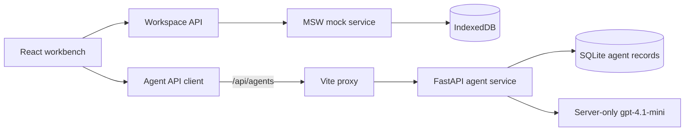

# CLIMADA frontend

CLIMADA is the browser workbench for the merchant typhoon cover prototype. It shows portfolios, synthetic storm analysis, operational actions, simulated payout batches, evidence and the three-stage agent review workspace.

## Start and verify

Use Node.js 22.12 or newer. From this directory:

```sh
npm ci
npm run dev
```

Open `http://127.0.0.1:5173`. The browser starts with no business records. Choose **Explore demo** to load synthetic records or import a portfolio. IndexedDB retains the local workspace after refresh; **Reset workspace** clears it.

The agent panel also needs the FastAPI service running at `http://localhost:8000`; see [the backend guide](../backend/README.md). Vite proxies `/api/agents` to that service. `VITE_AGENT_API_BASE_URL` can override the agent base URL, but the local default is `/api/agents`.

The business workspace and numerical model records remain simulated. MSW handles `/api/workspace` and `/api/commands`, while IndexedDB stores the state. The default is `VITE_DATA_MODE=mock` from `.env.example`. `VITE_DATA_MODE=http` changes the workspace client to an external business API; the current FastAPI service exposes the agent routes only and does not replace those workspace routes. The live agent provider receives the selected synthetic snapshot.

Run the frontend checks from this directory:

```sh
npm test
npm run build
npx playwright install chromium
npx playwright test
```

The verified frontend results are 13 Vitest tests and eight standard Playwright tests. The browser tests start or reuse the local development server. Set `TEST_CHROME` to an existing Chromium executable when using a managed browser installation.

The live agent check is opt-in because it consumes provider calls. From this directory, set `RUN_LIVE_AGENT_TEST=1` and run the dedicated spec:

```powershell
$env:RUN_LIVE_AGENT_TEST='1'
# Optional: $env:TEST_CHROME='C:\path\to\chromium.exe'
npx playwright test agents-live.spec.ts
```

The verified live result is one passed Playwright test against the configured OpenAI `gpt-4.1-mini` provider, using synthetic fixtures only. Run the backend checks from `backend` with [the backend command](../backend/README.md); the verified result is 15 pytest cases.

## Demonstration flow

1. Choose **Explore demo**, then confirm **Load demo dataset**, or import merchant records.
2. Select a product rule and run a risk analysis in the Storm Workspace. Advance the synthetic bulletins to settlement when you need payout evidence.
3. Open **Agents** after a compatible `completed` or `partial` risk result exists. The client sends the selected portfolio, storm, bulletin, rule, model result, actions and batches as one snapshot.
4. Follow **Intelligence → Operations → Review**. Inspect the evidence citations and draft tasks.
5. A human can accept, dismiss or complete a proposal. Acceptance records an operational decision only; it does not approve or pay a payout batch and does not send a message.
6. Use **Actions & Payouts** for the separate simulated approval, payment, reconciliation and retry demonstration.

Partial risk input can produce a review, but the server downgrades a `ready` verdict to `needs_review`. Forecast evidence cannot authorise settlement. A failed or interrupted agent run must be explicitly retried.

## Frontend boundaries



`src/contracts.ts` defines the business records. `src/agents/contracts.ts` defines the agent snapshot, run, stage, fact, proposal and health shapes. `src/agents/api.ts` validates responses and calls the agent routes. `src/mocks/engine.ts`, `src/mocks/browser.ts` and IndexedDB remain the simulated business engine.

The client marks a run compatible only when its portfolio version, storm, model run, bulletin, rule and model input fingerprint match the current snapshot. Historical accepted and completed proposals remain visible for context, while decisions for stale runs are disabled. The backend validates a decision's `inputHash` against the stored frozen run; the current-browser freshness check happens in the UI and is not a production trust boundary. The browser-supplied snapshot is useful for this local integration boundary, but it is not a trusted production source. Production would need authenticated, server-owned policy and model records.

## Agent API used by the client

The agent client defaults to `/api/agents` and uses these routes:

| Route | Purpose |
|---|---|
| `GET /health` | Report provider configuration and model name |
| `GET /runs?portfolioId=&stormId=` | List persisted runs for the current selection |
| `POST /runs` | Freeze and queue one snapshot; returns `202` |
| `POST /runs/{runId}/retry` | Queue a new attempt for a failed or interrupted run |
| `POST /runs/{runId}/proposals/{proposalId}` | Human `accept`, `dismiss` or `complete` decision |

Requests include a `requestId`. Decisions and retries also include `expectedVersion`; decisions include `inputHash`. The backend returns a conflict when the request is duplicated with a different payload, the run version is stale or the supplied fingerprint does not match the stored frozen run.

## Current limits

- Portfolio, storm, risk and payout numbers are synthetic browser records. They are not calibrated CLIMADA outputs, certified triggers or approved insurance terms.
- The agent service validates facts, entity references, timestamps, counts, amounts and model status before calling the provider. Findings and proposals are checked against server-generated fact IDs. Agent text never becomes numerical authority.
- The agent service is advisory and local-only. It has no authentication, payment capability, notification capability or production authorization boundary.
- The local SQLite agent database is created at `backend/data/agents.sqlite3`. In-flight work is marked failed after a service restart so an operator can retry it explicitly.
- Distinct runs are independent; the service does not guarantee semantic de-duplication of similar tasks across runs.
- Keep provider credentials in the ignored `backend/.env`; never put them in `frontend/.env`, browser code, snapshots, logs or documentation.
- The map uses bundled Natural Earth geometry by default and may use CARTO tiles when configured. See the existing [map attribution notes](src/assets/README.md).
